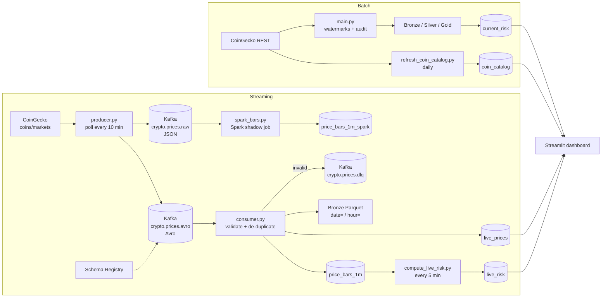

# RiskCoin

[](https://github.com/anthony6605/Risk-Crypto-Currency-Detected-/actions/workflows/ci.yml)

Crypto risk monitoring for the top 100 coins: CoinGecko prices are polled every 10 minutes and sent
through Kafka into PostgreSQL (micro-batch ingestion from a REST API), where each coin gets a volatility
and drawdown based risk score every 5 minutes, shown on a Streamlit dashboard.


## Architecture



Everything runs in Docker Compose: PostgreSQL 18, Kafka 3.8 (KRaft, no ZooKeeper), Confluent Schema
Registry, the producer, the consumer, two scheduled jobs, a Spark Structured Streaming job and the
dashboard.

## Quickstart

Requirements: Docker Desktop and a free [CoinGecko Demo API key](https://www.coingecko.com/en/api).

```bash
git clone https://github.com/anthony6605/Risk-Crypto-Currency-Detected-.git
cd Risk-Crypto-Currency-Detected-
cp .env.example .env        # add your CoinGecko key and a database password
docker compose up -d --build
```

Open http://localhost:8501. The producer polls as soon as it starts, so prices appear within a minute.
Risk scores take longer: a coin is scored once it has 60 price updates in the last 24 hours, which is
about 10 hours of polling. Until then the dashboard shows how close the coins are.

To load 30 days of hourly CoinGecko history for the top 100 coins (the Batch history tab):

```bash
docker compose run --rm batch
```

Useful commands (see `Makefile`): `make logs`, `make psql`, `make test`, `make down`.

| Service | Address |
|---------|---------|
| Dashboard | http://localhost:8501 |
| PostgreSQL | `localhost:5433`, user and database from `POSTGRESQL_*` in `.env` |
| Kafka | `localhost:9092` |
| Schema Registry | http://localhost:8081 |
| Spark UI | http://localhost:4040 |

Programs run on your Mac use `.env` as it is (`localhost:5433`); inside Docker, `docker-compose.yml`
points them at `postgres:5432` and `kafka:29092` instead.

**CoinGecko API budget.** The free Demo plan allows about 10,000 calls a month (30 a minute). Polling uses
about 4,300 (one call returns all 100 coins), the daily batch about 3,100 (one call per coin) and the coin
catalog about 120, so together they are close to the limit. To save calls, raise
`poll_interval_seconds` in `config/stream.yaml` or lower `top_n.size` in `config/coins.yaml`.

## Features

**Micro-batch ingestion through Kafka.** Every 10 minutes the producer makes one `/coins/markets` request
for the top 100 coins by market cap, leaving out 45 pegged and wrapped assets (stablecoins, tokenized gold,
wrapped and staked coins; see `config/coins.yaml`). It publishes one event per coin, keyed by symbol so
each coin's events stay in order on one partition, to a JSON topic and an Avro topic. It skips coins that
CoinGecko hasn't updated since the last poll, and when two coins share a symbol the bigger one wins.
Idempotent, `acks=all` delivery; a failed poll is retried at the next interval.

**Avro and Schema Registry.** Events follow an Avro schema (`schemas/price_event.avsc`) registered in
Confluent Schema Registry with BACKWARD compatibility. A one-off `schema-init` container registers it
after a compatibility check, and the producer can't register schemas itself (`auto.register.schemas` is
off). The consumer reads the Avro topic; switching back to JSON is one setting (`EVENT_FORMAT`).

**Reliable processing.** The consumer commits Kafka offsets only after the Bronze Parquet and PostgreSQL
writes succeed (at-least-once). All writes are idempotent: latest-price upserts ignore older events,
1-minute OHLC bars merge with min/max/earliest/latest rules, and events de-duplicate on `event_id`.

**Data quality.** Every event is validated: required fields and types, schema version, positive price,
non-negative volume, price within its 24 h range (1% tolerance), and an event time in UTC that is neither
in the future nor more than an hour old. Invalid messages, including Avro that can't be decoded, go to a
dead-letter topic with the reason and source offset in headers. Each flush writes an audit row with
consumed, loaded and rejected counts.

**Live risk scoring.** Every 5 minutes, for each coin with at least 60 price updates in the last 24 hours:
prices are put on a 1-minute grid (a minute without an update keeps the last price), then 1 h and 24 h
annualised volatility, the 24 h return and the maximum drawdown are combined into a 0-100
percentile-based score and a LOW / MEDIUM / HIGH / EXTREME level.

**Spark shadow job.** Spark Structured Streaming builds the same 1-minute bars from the JSON topic into
its own table, `price_bars_1m_spark`: a 2-minute watermark, de-duplication on `event_id` within the
watermark, upserts from `foreachBatch`, and a checkpoint that survives restarts. Because both pipelines
read the same events, their bars can be compared row by row.

**Incremental batch history.** CoinGecko history loads use per-coin watermarks and the
`market_chart/range` endpoint, so each run fetches only new data; Silver merges de-duplicate so reruns
are safe. The coin universe is configurable (`config/coins.yaml`) and requests are throttled for the free
API tier. On a Mac, `scripts/run_pipeline.sh` can run it from cron every hour; it runs at most once a day.

**Coin catalog.** A daily job reads the top 1,000 coins and maps each symbol to its CoinGecko id, name and
market cap, resolving symbol collisions by market cap, with manual overrides in
`config/symbol_overrides.yaml`.

**Dashboard.** Streamlit, refreshed every 60 seconds: a ranked live risk table with filters, a 24 h price
chart and risk features per coin, pipeline health (data freshness, rejected events, stream throughput,
job runs) and the batch risk table.

## By the numbers

| Metric | Value |
|--------|-------|
| Coins tracked | 100 (top 100 by market cap, minus 45 pegged and wrapped assets) |
| Price events per day | up to 14,400 (100 coins × 144 polls) |
| Average consumer flush time | 0.14 s for a 100-event poll |
| Symbols in the coin catalog | 978 |
| Coins with hourly history (batch) | 101 |
| CoinGecko calls per month | about 7,500 of the free plan's 10,000 |
| Automated tests | 47 (44 unit, 3 PostgreSQL integration) |

## Tech stack

Python 3.12 · Kafka 3.8 (KRaft) · Confluent Schema Registry · Avro · Spark 4.0 Structured Streaming ·
PostgreSQL 18 · SQLAlchemy · pandas · PyArrow / Parquet · confluent-kafka · Streamlit · Docker Compose ·
pytest · Ruff · GitHub Actions

## Project structure

```
config/
  coins.yaml                coin universe (top 100 and exclusions)
  stream.yaml               poll interval and Kafka topics
  symbol_overrides.yaml     manual symbol -> CoinGecko id fixes
schemas/price_event.avsc    Avro schema for price events
src/
  ingestion/coingecko.py    CoinGecko API client
  streaming/
    producer.py             CoinGecko -> Kafka (JSON + Avro)
    consumer.py             Kafka -> Bronze + PostgreSQL (+ DLQ)
    validation.py           data quality rules
    bars.py                 1-minute OHLC bars
    avro_codec.py           Avro encoding with Schema Registry
    register_schema.py      registers the schema after a compatibility check
    spark_bars.py           Spark Structured Streaming shadow job
  risk/live_features.py     volatility, drawdown, risk score
  jobs/
    compute_live_risk.py    every 5 minutes
    refresh_coin_catalog.py daily
  pipeline/incremental.py   watermark windows for batch history
  transformation/, quality/ batch features, risk score and data checks
  database/                 schema, loaders, control tables (watermarks, audit)
app/dashboard.py            Streamlit dashboard
main.py                     batch history pipeline
scripts/                    operational tools (below)
tests/                      unit + PostgreSQL integration tests
```

Operational tools in `scripts/`:

- `check_stream.py` reads the JSON topic and checks ordering, partitioning and duplicate events.
- `inspect_dlq.py` counts dead-letter messages by reason, with an example of each.
- `kafka_smoke_test.py` does a produce/consume round trip on its own `crypto.smoke_test` topic.
- `rebuild_bars.py` rebuilds a day's 1-minute bars from Bronze Parquet.
- `validate_coins.py` checks the CoinGecko ids in `config/coins.yaml`.
- `run_pipeline.sh` wraps the batch for cron (once a day, with a lock and a database check).

## Data model

| Table | Grain | Written by |
|-------|-------|------------|
| `live_prices` | one row per coin, latest price | consumer |
| `price_bars_1m` | one row per coin per minute with an update (8 days kept) | consumer |
| `price_bars_1m_spark` | the same bars, built by Spark | Spark job |
| `live_risk` | one row per scored coin | live risk job |
| `coin_catalog` | one row per symbol | coin catalog job |
| `current_risk` | one row per coin (CoinGecko history) | batch pipeline |
| `pipeline_watermarks` | one row per pipeline and coin | batch pipeline |
| `pipeline_audit` | one row per run, coin or stream flush | every job |
| view `live_prices_enriched` | live prices joined to the catalog | |

## Design decisions

- **CoinGecko as the only source.** One `/coins/markets` call returns all 100 coins, so polling every 10
  minutes fits the free plan next to the daily batch, and CoinGecko refreshes these prices only about
  once a minute anyway. Exchange WebSockets push every second for free, but Binance.com blocks US users
  and Binance.US had too few active pairs, so this project trades latency for one reliable source.
- **Micro-batches, not real-time.** Each poll produces one event per coin, so the 1-minute bars are
  sparse. The risk features put prices on a 1-minute grid first; otherwise a 10-minute move would count
  as a 1-minute move and every coin would look far more volatile than it is.
- **Kafka between source and sink.** Decouples ingestion from processing: the producer keeps collecting if
  the consumer or database is down, and the 24 h retention allows replay.
- **At-least-once plus idempotent writes instead of exactly-once.** Simpler than Kafka transactions and
  gives the same end state for this data. Proven by integration tests that replay batches.
- **Coin as the Kafka key.** Guarantees per-coin ordering while allowing parallel consumers across 6
  partitions.
- **Avro migration by dual-writing.** The producer writes both topics, so the consumer moved to Avro with
  one setting and can move back the same way. BACKWARD compatibility means a new schema can always read
  old events.
- **Spark as a shadow job.** It runs next to the Python consumer on the same events but writes to its own
  table, so it can be checked against the existing bars before anything depends on it.
- **Pure functions for business logic.** Bars, validation, risk features and the dashboard's health rules
  have no I/O, so they're unit tested in isolation; jobs only handle reading and writing.
- **Relative risk score.** Percentile ranks across coins need no hand-tuned thresholds and are easy to
  explain; the trade-off is that the score says "riskier than the rest of the market", not an absolute level.

## Testing

```bash
python3 -m venv venv
venv/bin/pip install -r requirements.txt -r requirements-dev.txt
make test       # unit tests
make test-db    # PostgreSQL integration tests in a throwaway container
make lint
```

CI runs lint, unit tests, integration tests against a PostgreSQL service container, and a Docker build on
every push.

## Limitations and next steps

- Prices update every 10 minutes, the free API's practical limit, so "live" means minutes, not seconds,
  and a coin needs about 10 hours of polling before it gets a risk score.
- On a laptop the stream pauses while the computer sleeps. After it wakes, Docker's clock can lag for a
  few minutes, so the first poll is rejected as `event_time_in_future` and lands in the dead-letter topic.
- Single Kafka broker with replication factor 1; production would use 3 brokers.
- Bronze is on local disk; object storage (S3) would be the production choice.
- Health checks are on the dashboard but don't send alerts yet.
- One data source; a second one (an exchange API) would allow cross-checking prices.
